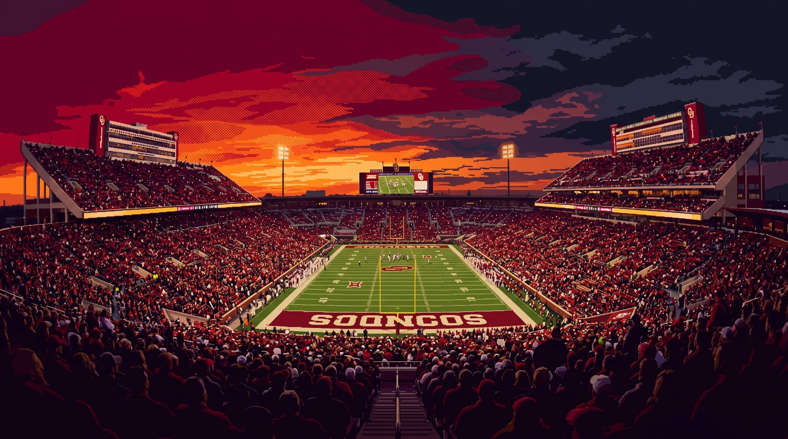
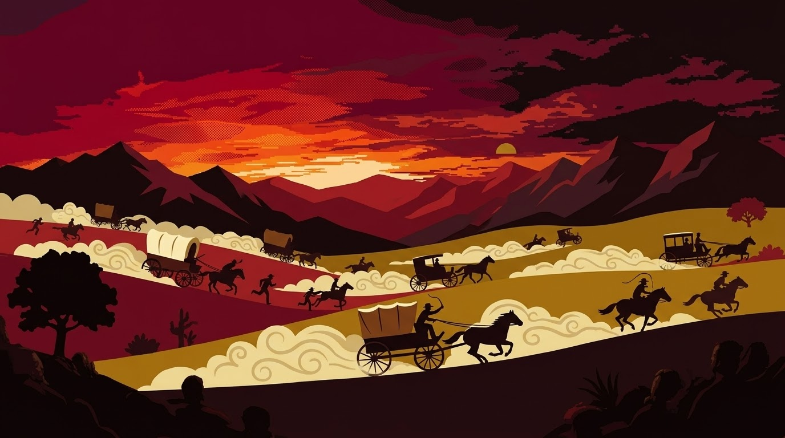
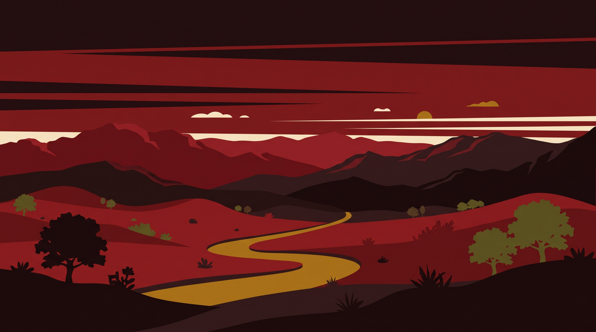
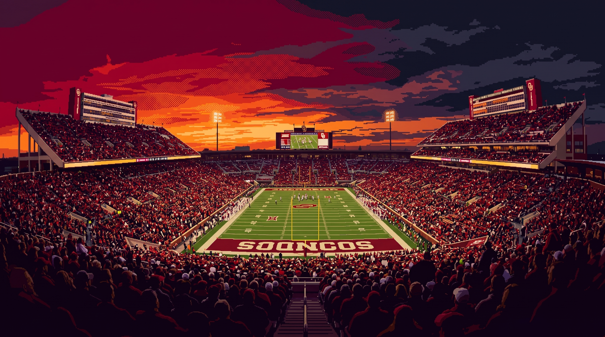

# Crimson

Dark theme for Omarchy. Pairs the full warm-illustration wallpaper set
with a deep warm-red-tinged near-black background (`#1a0a0b`) and
warm cream foreground (`#f3e9d2` → `#fffaf0`).

The palette is anchored on a deep warm red (`#841617`) as the accent.
The Hyprland active-border uses a warm-red-to-bright-warm-red gradient
that echoes the sunset in every shipped wallpaper without going neon.

Cream appears here only as readable terminal/UI foreground — never as
a solid background fill.

## Wallpapers

Cycle with `omarchy theme bg next` or pin one with `omarchy theme bg set <path>`:

| Index | File | Source |
|-------|------|--------|
| `0` | `0-boomer.webp` | pixel-art stadium at sunset |
| `1` | `1-sooner-run.jpeg` | Wild West wagons at warm-red sunset (1889 Land Run) |
| `2` | `2-oklahoma.jpg` | poster art: warm-red hills, golden river |
| `3` | `3-ou-stadium.jpg` | stadium photographic |






Pair matching intro videos in `backgrounds/intros/` by basename (e.g.
`intros/0-boomer.mp4` plays when wallpaper `0` is selected). See
`docs/theming.md` in the Omarchy repo for supported video formats and
duration guidance (5–7 seconds recommended).

## Palette

| Role | Hex |
|------|-----|
| `accent` (warm red) | `#841617` |
| `foreground` | `#f3e9d2` |
| `bright_foreground` | `#fffaf0` |
| `background` | `#1a0a0b` |
| `dark_background` | `#120708` |
| `darker_background` | `#0b0405` |
| `lighter_background` | `#241012` |
| `selection` | `#3a0a0c` |
| `muted` | `#5a544b` |

ANSI ramps follow the standard 16-color Omarchy schema (red/yellow/
orange/green/cyan/blue/magenta/brown + bright variants). Contrast
ratios against `background`:

- `foreground` against `background` ≈ 11.5:1 (WCAG AAA)
- `accent` (warm red) against `background` ≈ 4.3:1 (WCAG AA large text)
- `bright_foreground` against `background` ≈ 13.1:1 (WCAG AAA)

## Sister themes

| Theme | Mode | Wallpaper |
|-------|------|-----------|
| `cream/` (as `noodling/`) | light | warm cream/burgundy illustrations |
| `crimson/` | dark | the four wallpapers in this theme |

## What's shipped

- `colors.toml` — full 26-key palette + the active-border gradient.
- `shell.toml` — overrides for the bar, notifications, menu, lock,
  polkit, launcher, and image-picker sections only. Everything else
  is generated from `default/themed/shell.toml.tpl`.
- `icons.theme` — `Yaru-red` (closest stock icon theme to the warm-red
  accent).
- `backgrounds/0-boomer.webp`, `1-sooner-run.jpeg`, `2-oklahoma.jpg`,
  `3-ou-stadium.jpg` — four wallpapers selectable via the background
  picker.
- `backgrounds/intros/` — empty; add matching `0-boomer.<ext>`,
  `1-sooner-run.<ext>`, etc. to pair videos with wallpapers (see
  `default/themed/*.tpl`).

## What's intentionally NOT shipped

The following are blocked by the cloned-theme denylist
(`INSTALLED_THEME_DENIED` in `bin/omarchy-theme-set`) and would be
dropped at staging anyway:

- `*.lua` (Hyprland / Neovim / gum_env)
- terminal configs (`alacritty.toml`, `foot.ini`, `ghostty.conf`,
  `kitty.conf`)
- `vscode.json`

They are generated from `default/themed/*.tpl` using the palette
above. If a theme update pulls new templates, the denylist is the
source of truth — see `docs/theming.md` in the Omarchy repo.

## Install

```
omarchy theme install https://github.com/<you>/omarchy-theme-crimson.git
omarchy theme set crimson
omarchy theme bg next   # cycle through the four wallpapers
```

Or locally:

```
cp -r ./* ~/.config/omarchy/themes/crimson/
omarchy theme set crimson
```

## Credits

- Wallpapers: user-supplied illustrations (ensure you have the right
  to redistribute each before shipping). The four images share a warm
  warm-red + cream palette that pairs naturally with the warm-red
  accent.
